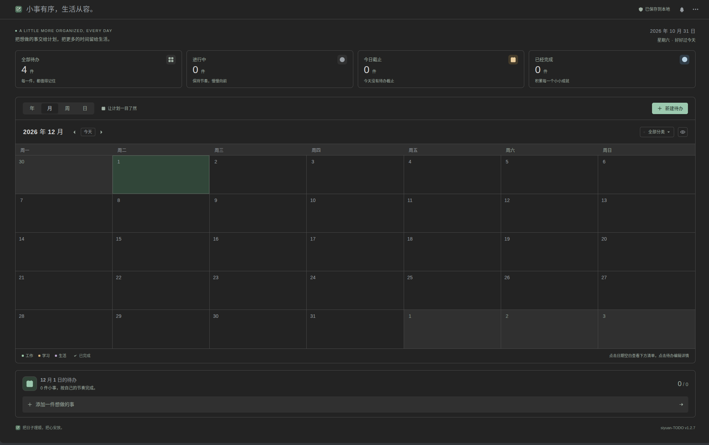

# siyuan-TODO

An offline task plugin for SiYuan, with task lists, reminders, completion history, and year/month/week/day calendars. The current user interface is in Simplified Chinese.

[简体中文](README.md) · [Report an issue](https://github.com/wave789/siyuan-TODO/issues)

## Features

- Create, edit, search, sort, and complete tasks from the left dock. Open multiple task editors in one workspace.
- Browse four calendar views and select a date to see its complete task list.
- Set start and end times to the minute, with optional start and deadline reminders.
- Freeze time progress at completion and record overdue completion times.
- Use category colors and follow SiYuan's light or dark theme.
- Store tasks in a local JSON file and import/export backups.

## Installation

Requires **SiYuan 3.8.0 or later** on Windows, macOS, or Linux, or a desktop browser connected to one of these kernels.

Once listed, search for **siyuan-TODO** in SiYuan's plugin marketplace, download it, and enable it. For manual installation, download `package.zip` from [Releases](https://github.com/wave789/siyuan-TODO/releases), exit SiYuan, and extract it into `data/plugins/siyuan-todo/` in your workspace. `plugin.json` must be directly inside that directory. Restart SiYuan and enable the plugin.

Click the plugin icon in the far-left dock. Use the plus button to create a task or click an existing task to edit it. New tasks default to 09:00–18:00 on the selected date. Import, export, and reminder settings are available from the top-right menu.

Reminders are checked every 15 seconds while SiYuan and the plugin are running. They cannot fire while the application is closed or suspended; reopening catches up on missed reminders from the previous 24 hours. System notifications require permission.

## Local data

Tasks are stored at `data/storage/petal/siyuan-todo/todos.json` in the SiYuan workspace. Hover over the saved-status text to see the path. Export a JSON backup before upgrading, uninstalling, or moving workspaces. Import merges tasks by ID and keeps the newer record.

All runtime dependencies, icons, and styles are bundled. There are no CDNs, online fonts, accounts, telemetry, or external task services. File operations use the current SiYuan kernel's local file API. SiYuan's own synchronization is controlled by the host settings.

## Development

Use Node.js 22.16 or later, then run `npm ci`, `npm test`, and `npm run build`. `npm run dev` starts a browser preview with separate local data and sample tasks. Versioned build directories in `dist/` contain the marketplace `package.zip` and a ZIP with a versioned filename.

See [PUBLISHING.md](https://github.com/wave789/siyuan-TODO/blob/main/PUBLISHING.md) for the release process. Report bugs in [Issues](https://github.com/wave789/siyuan-TODO/issues), including plugin/SiYuan versions and reproduction steps.

## License

The project uses [Apache-2.0](LICENSE). Icons are original SVG artwork. The release includes full license notices for React, React DOM, and Scheduler in `THIRD_PARTY_NOTICES.md`.
