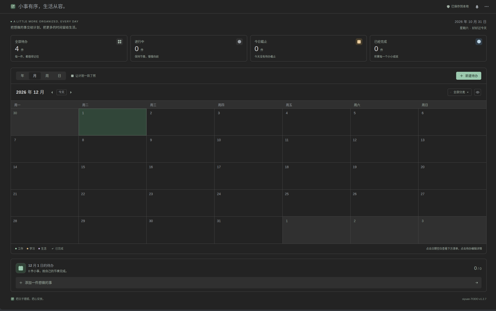

# siyuan-TODO

一个完全离线运行的思源笔记桌面端待办插件，包含创建、提醒、记录及日历视图。

[English](README.en.md) · [反馈问题](https://github.com/wave789/siyuan-TODO/issues)



## 功能

- 左侧待办列表，可创建、编辑、搜索、排序和勾选完成；右侧支持多个任务编辑标签。
- 年、月、周、日视图，点击日期查看当天完整清单，点击待办编辑详情。
- 开始、截止时间精确到分钟，可设置开始提醒和截止提醒。
- 显示时间进度，完成后保留当时的比例；逾期完成时显示逾期时长，并留下任务记录。
- 工作、学习、生活分类与对应颜色，界面跟随思源的明亮、暗黑主题。
- 全部任务保存为本地 JSON，支持导入、导出备份。

## 安装与使用

需要 **思源笔记 3.8.0 或以上**，支持 Windows、macOS、Linux 桌面客户端及连接这些内核的桌面浏览器。当前界面语言为简体中文。

上架后，可在思源「设置 → 集市 → 插件」中搜索 **siyuan-TODO**，下载并启用。也可以从本仓库 [Releases](https://github.com/wave789/siyuan-TODO/releases) 下载 `package.zip`，退出思源后解压到工作空间的 `data/plugins/siyuan-todo/`，重新打开思源并启用插件。`plugin.json` 应直接位于此目录内。

点击最左侧的插件图标打开待办列表；点击加号新建，点击已有卡片编辑。新建任务默认使用所选日期的 09:00～18:00。右上角「更多操作」菜单提供导入、导出和提醒设置。

提醒需要思源和插件保持运行，每 15 秒检查一次；休眠或关闭后不能准时提醒，恢复运行时补发最近 24 小时内遗漏的提醒。系统通知需要在插件设置中授权。

## 数据与离线使用

任务文件位于：

```text
思源工作空间/data/storage/petal/siyuan-todo/todos.json
```

鼠标停在右上角「已保存到本地」可查看保存路径。建议升级、卸载或迁移工作空间前导出一份 JSON 备份；导入按任务 ID 合并，保留更新时间较新的记录。

安装包包含全部运行依赖、图标和样式，不使用 CDN、在线字体、账号、遥测或外部任务服务。任务操作仅通过当前思源内核的本地文件 API 完成；思源自身的同步行为由宿主设置控制。

## 开发与发布

需要 Node.js 22.16 或以上：

```bash
npm ci
npm test
npm run build
```

`npm run dev` 启动浏览器预览。预览使用独立的浏览器本地存储，并在首次打开时提供示例任务。

构建产物保存在 `dist/` 的版本目录中，其中 `package.zip` 用于 GitHub Release 和思源集市，另保留带版本号的 ZIP。发布流程见 [PUBLISHING.md](https://github.com/wave789/siyuan-TODO/blob/main/PUBLISHING.md)。

## 反馈与支持

请通过 [GitHub Issues](https://github.com/wave789/siyuan-TODO/issues) 反馈，附上插件版本、思源版本及复现步骤。请勿上传含有私人任务内容的备份。

如愿意支持维护，可查看作者提供的[微信赞赏码](assets/wechat-reward.png)。赞赏完全自愿，不影响任何功能。

## 许可证

本项目采用 [Apache License 2.0](LICENSE)。图标为本项目自行绘制的 SVG；安装包附带 React、React DOM 和 Scheduler 的完整第三方许可说明 `THIRD_PARTY_NOTICES.md`。
